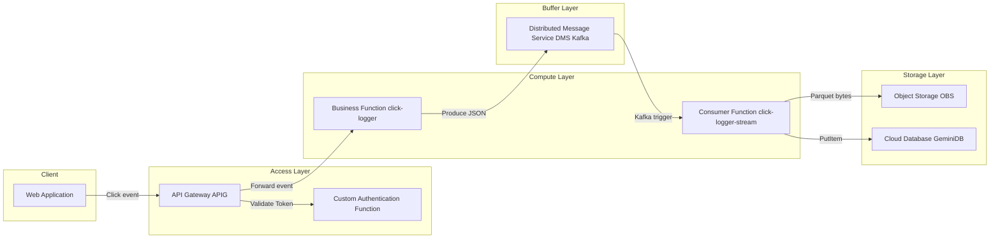

# data-integration-click-logs

[](LICENSE)
[](https://support.huaweicloud.com/intl/en-us/)
[](#)
> Click Log Ingestion: gateway intake, Kafka buffering, columnar landing, and key-value query in one complete pipeline
---

## 1. Overview

This practice presents a click log ingestion pipeline on Huawei Cloud: API Gateway receives click events from web applications, and a business function delivers the events to a Distributed Message Service (DMS Kafka) topic; a Kafka trigger asynchronously invokes a consumer function, which serializes the events into Parquet bytes, writes them to Object Storage Service (OBS) partitioned by date, and writes them to GeminiDB through a key-value protocol-compatible interface.

Every click and every page transition produces interaction signals. Landing them in near real time supports operational dashboards and accumulates unified raw data for subsequent offline analysis. This practice orchestrates ingestion, buffering, serialization, and storage into a pipeline whose stages can scale independently, reducing development and O&M effort for adopters. It applies to scenarios such as operational instrumentation, product funnel analysis, abnormal click auditing, and recommendation replay, and targets DevOps, backend, data engineering, and security operations engineers. It can be used as a reference architecture, a learning sample, or a production template.

### Core Capabilities

- **Gateway intake and allowlist authentication**: API Gateway calls a custom authentication function to validate the Token in the request header and only allows requests that match the allowlist.
- **Kafka buffering and stage decoupling**: The entry point only handles validation and delivery, while data landing is handled by the consumer function; the two stages can scale independently.
- **Columnar Parquet landing**: SNAPPY-compressed Parquet is written to OBS partitioned by date, enabling offline engines to perform column pruning and predicate pushdown.
- **Key-value protocol writes**: Events are also written to GeminiDB, so existing key-value data models and client code can be reused.
- **End-to-end observability**: Runtime logs from the gateway, functions, and Kafka are centralized in Log Tank Service (LTS) for easier troubleshooting.
- **Infrastructure as code**: All resources are described by Terraform and function code is organized as Maven projects, making it easy to integrate into CI/CD.

---

---

## 2. Table of Contents

- [1. Overview](#1-overview)
- [2. Table of Contents](#2-table-of-contents)
- [3. Architecture Diagram](#3-architecture-diagram)
- [4. Highlights](#4-highlights)
- [5. Cloud Services Used](#5-cloud-services-used)
- [6. Prerequisites](#6-prerequisites)
- [7. Quick Start](#7-quick-start)
- [8. Step-by-Step Deployment](#8-step-by-step-deployment)
- [9. Usage / Verification](#9-usage--verification)
- [10. Cleanup](#10-cleanup)
- [11. Detailed Explanation](#11-detailed-explanation)
- [12. Dependencies](#12-dependencies)
- [13. FAQ / Troubleshooting](#13-faq--troubleshooting)
- [14. Contributing](#14-contributing)
- [15. License](#15-license)
- [16. Contact / Maintainers](#16-contact--maintainers)

---

---

## 3. Architecture Diagram

> A DMS Kafka message queue separates the external intake from data landing: the entry point is lightweight and data landing can scale independently.



**Key Components**:

- **API Gateway (APIG)**: The sole external entry point, responsible for request routing and custom authentication.
- **FunctionGraph**: Hosts three responsibilities: custom authentication, event delivery, and stream consumption.
- **Distributed Message Service (DMS Kafka)**: The streaming buffer between the business entry point and data landing; the Kafka trigger invokes the consumer function.
- **Object Storage Service (OBS)**: Stores Parquet bytes partitioned by date as a unified data source for offline analysis.
- **Cloud Database GeminiDB**: Stores event records in key-value protocol-compatible tables, supporting real-time reads by primary key.

---

---

## 4. Highlights

- **Two-step pipeline + Kafka buffering**: The business entry point only handles validation and delivery, while data landing is handled by the consumer function. Business writes and data landing are decoupled, can scale independently, and preserve the pipeline semantics of "stream buffering + format conversion + multi-destination delivery".
- **Parquet columnar storage**: The consumer function lands data in columnar Parquet format with SNAPPY compression, allowing offline analytics engines to perform column pruning and predicate pushdown directly for more efficient scans.
- **Token custom authentication**: API Gateway validates the Token in the request header through a custom authentication function; only requests matching the allowlist are allowed, effectively blocking illegal writes.
- **Key-value protocol-compatible GeminiDB table storage**: The consumer function writes to GeminiDB through a key-value-style interface, so existing data models and client code can be reused without rewriting the data access layer.
- **OBS lifecycle management**: Object storage stores Parquet partitioned by date, with a 30-day expiration cleanup configured for the `clicklog/` prefix to keep the storage structure clear and controllable.
- **Near-real-time consumption via Kafka trigger**: A Kafka trigger enables a near-real-time "event in → function consumes" pipeline, reducing API response latency compared with synchronous database writes.

---

---

## 5. Cloud Services Used

| Service | Purpose | Notes |
|---|---|---|
| API Gateway (APIG) | Receives click events and performs custom authentication | Custom authentication enabled on the instance, bound to the authentication function |
| FunctionGraph | Runs the authentication, delivery, and consumption functions | Java 8 runtime; business and consumer functions are bound to a VPC |
| Distributed Message Service (DMS Kafka) | Acts as the streaming buffer channel | Single topic with 1 partition, plaintext access within the VPC |
| Object Storage Service (OBS) | Stores Parquet files and function code packages | Bucket name must be globally unique; versioning enabled |
| Cloud Database GeminiDB | Stores event records in key-value protocol-compatible tables | Key-value protocol-compatible interface, 3-node cluster |
| Identity and Access Management (IAM) | Issues agencies for functions to access other cloud services | Agency grants cover object storage and the Kafka topic |
| Log Tank Service (LTS) | Aggregates runtime logs of functions, Kafka, and the gateway | Each function is bound to one log stream |
| Virtual Private Cloud (VPC) | Hosts the network plane for functions and the database | Dedicated subnet and security group to reduce the exposure surface |

> **Note**: All of the above resources can be created with one command through the Terraform configuration in this repository. For cleanup, see [Section 10: Cleanup](#10-cleanup).

---

---

## 6. Prerequisites

| Item | Requirement | Description |
|---|---|---|
| **Account** | A Huawei Cloud account opened with real-name verification completed | Personal or enterprise accounts are both acceptable |
| **Permissions** | IAM **Tenant Administrator** or equivalent permissions | Used to create VPC, APIG, FunctionGraph, GeminiDB, and other resources |
| **Region** | `cn-north-4` recommended | Service availability may differ across regions |
| **Terraform** | `>= 1.5.0` | IaC deployment tool |
| **huaweicloud Provider** | `~> 1.97` | Huawei Cloud Terraform Provider |
| **JDK / Maven** | Java 8 (function runtime is Java 8), Maven `>= 3.6` | Build function code packages locally |
| **Function runtime interface package** | Download per `src/clicklogger/lib/README.md` and place it under `src/clicklogger/lib/` | Without this package, the local build fails because the runtime interface cannot be found |
| **Account domain name** | Obtain from the basic information on the "My Credentials" page | Used as the owning account of the IAM agency; fill into `domain_name` |
| **obsutil** *(optional)* | `>= 5.5.0` | View/download objects in OBS buckets (as needed) |
| **AK/SK** | Obtain the Access Key ID and Secret Access Key on the Huawei Cloud "My Credentials" page and fill them into the deployment script | **Do not** write credentials into any code or configuration file |

---

---

## 7. Quick Start

### One-Click Deployment (Recommended)

```bash
# 1. Clone this repository
git clone https://github.com/huaweicloud-samples/data-integration-click-logs.git data-integration-click-logs
cd data-integration-click-logs

# 2. Build the function code package (Terraform reads from the target/ directory)
cd src/clicklogger
mvn clean package -DskipTests
cd ../..

# 3. Prepare Huawei Cloud AK/SK (see Prerequisites §6)
export HW_ACCESS_KEY="<your-access-key>"
export HW_SECRET_KEY="<your-secret-key>"
export TF_VAR_geminidb_password="<your-instance-password>"

# 4. Declare the account domain name
cd infra
cp terraform.tfvars.example terraform.tfvars
# Edit terraform.tfvars to fill in domain_name and obs_bucket_name

# 5. One-click deployment
terraform init
terraform plan
terraform apply
```

> **Deployment time**: about 10-20 minutes (including function code package upload and GeminiDB instance creation).
> **Two final steps remain after deployment** (set the function secret configuration items and fill in the key-value store endpoint). For the full steps and the expected output of each step, see [Section 8: Step-by-Step Deployment](#8-step-by-step-deployment).

---

---

## 8. Step-by-Step Deployment

### Step 1: Get the Code

```bash
cd data-integration-click-logs
```

**Expected output**: The current directory contains files and directories such as `infra/`, `src/`, `docs/`, and `README.md`.

### Step 2: Build the Java Function

```bash
cd src/clicklogger
mvn clean package -DskipTests
```

**Expected output**: `BUILD SUCCESS` appears and `clicklogger-1.0-SNAPSHOT.jar` is generated under `src/clicklogger/target/`. Terraform uploads this file to OBS as the shared code package for all three functions. If no Maven mirror is configured locally, the first build downloads many dependencies; keep the network connected.

### Step 3: Initialize the Infrastructure

```bash
cd ../infra
terraform init
```

**Expected output**: `Initializing the backend...` and `Terraform has been successfully initialized!` appear, and a local `.terraform` directory is generated.

### Step 4: Validate and Preview

```bash
terraform validate
terraform plan
```

**Expected output**: `Success! The configuration is valid.` appears first, then plan lists the resources to be created.

### Step 5: Apply the Deployment

```bash
terraform apply
```

**Expected output**: Resources are created one by one, ending with `Apply complete!`, and output values such as `apig_api_url`, `obs_bucket_name`, `geminidb_instance_id`, and `functiongraph_click_logger_urn` are printed. Record these values; they are needed for later verification.

### Step 6: Set Function Secret Configuration Items

For credential security, access keys and the database password are not delivered with the infrastructure code. Add them separately in the "Configuration" tab of the function details page:

| Function | Configuration Item | Value |
|---|---|---|
| `data-integration-click-logs-click-logger` | `HUAWEICLOUD_SDK_AK` / `HUAWEICLOUD_SDK_SK` | Access Key ID and Secret Access Key obtained on the "My Credentials" page |
| `data-integration-click-logs-click-logger-stream` | `HUAWEICLOUD_SDK_AK` / `HUAWEICLOUD_SDK_SK` | Same as above, used to access OBS |
| `data-integration-click-logs-click-logger-stream` | `GEMINIDB_PASSWORD` | Same as `geminidb_password` in `terraform.tfvars` |

**Expected output**: After saving, the function does not need to be redeployed; the configuration items take effect on the next invocation.

### Step 7: Fill in the Key-Value Store Endpoint

The endpoint of the key-value store-compatible interface is instance-level and cannot be derived from the region. After the instance is created, take the load balancer address returned by `terraform output -raw geminidb_endpoint`, add the protocol and port, and fill it into `geminidb_endpoint` in `terraform.tfvars` (in the form `http://<load-balancer-address>:8000`; use the port shown on the instance details page in the console):

```bash
terraform output -raw geminidb_endpoint
# Complete the result as http://<load-balancer-address>:<port> and write it to geminidb_endpoint in terraform.tfvars
terraform apply
```

**Expected output**: The second apply only updates the consumer function's configuration item (`GEMINIDB_ENDPOINT`), showing a few in-place changes.

---

---

## 9. Usage / Verification

> **Verification Notice**: The commands and examples in this section have passed static checks (`terraform fmt -check`, `terraform validate`) and code-level inspection; the end-to-end pipeline must be executed in a real account environment following the steps below. Only after confirming that all four paths (gateway authentication, Kafka delivery, object storage writes, and key-value store writes) work properly can the delivery be considered complete.

### Verification 1: Gateway Authentication and Event Acceptance

```bash
# Send a click event (<apig-url> comes from terraform output apig_api_url)
curl -X POST https://<apig-url>/clicklogger \
  -H "Authorization: ALLOW=ORDERAPP" \
  -H "Content-Type: application/json" \
  -d '{"requestid":"r-001","contextid":"c-001","callerid":"web","component":"login","action":"click","type":"webpage","user":"alice","clientip":"10.0.0.1"}'
```

**Expected output**:

```
{"message":"ok"}
```

The HTTP status code is 200. Send another request that does not match the allowlist (`-H "Authorization: ALLOW=OTHER"`); it is expected to return HTTP 401 and be rejected by the gateway.

### Verification 2: Object Storage Landing

```bash
# List objects under today's partition (obsutil must be configured first)
obsutil ls obs://<bucket-name>/clicklog/data=YYYY-MM-DD/
```

**Expected output**: An object such as `<timestamp>-r-001.parquet` appears, about 1-3 KB in size (a single record).

### Verification 3: Key-Value Store Writes

Search the log stream of function `data-integration-click-logs-click-logger-stream` in LTS and confirm the following appears:

```
record stored, requestid=r-001
```

This line is printed by the consumer function after `PutItem` succeeds and is direct evidence of a successful key-value write; the same log stream also shows `object stored, key=clicklog/data=.../...-r-001.parquet`. You can also use any key-value protocol-compatible client to read the record by primary key `requestid=r-001` and `contextid=c-001`.

### Verification 4: End-to-End Business Flow (Recommended)

```bash
# Send three events from different callers in a row to cover allowlist and field validation
for n in 001 002 003; do
  curl -s -o /dev/null -w "%{http_code}\n" -X POST https://<apig-url>/clicklogger \
    -H "Authorization: ALLOW=ORDERAPP" \
    -H "Content-Type: application/json" \
    -d "{\"requestid\":\"r-$n\",\"contextid\":\"c-$n\",\"callerid\":\"web\",\"component\":\"login\",\"action\":\"click\",\"type\":\"webpage\"}"
done
```

**Expected result**: All three requests return `200`; after a few seconds (the Kafka trigger invokes the consumer function in batches, with `pull_period` of 30 seconds), three new Parquet objects appear under `obs://<bucket-name>/clicklog/data=YYYY-MM-DD/`, and three records with primary keys `r-001` / `r-002` / `r-003` appear in `click_log_table`.

> **Note**: Because the pipeline consumes asynchronously through a Kafka topic, landing and writes are delayed by seconds to tens of seconds relative to the HTTP response; this is expected.
>
> After deployment, follow these steps to verify that the business functionality works before considering the delivery complete.

---

---

## 10. Cleanup

```bash
# Enter the deployment directory
cd data-integration-click-logs/infra

# Release all resources with one command
terraform destroy
```

**Expected output**: `Destroy complete! Resources: N destroyed.`

> **Avoid leftover resources**:
> - `terraform destroy` only releases resources tracked in Terraform state. The OBS bucket in this practice has `force_destroy` enabled, so objects in the bucket are deleted along with it; if the bucket still contains objects not created by this deployment, empty it before destroying.
> - If resources were created directly through the API midway (for example, manually uploaded OBS objects or an EIP created manually in the console), release them manually.
> - Shared resources (NAT / VPC etc. shared by other tasks in the account) are not affected.

---

---

## 11. Detailed Explanation

### 11.1 Workflow

1. **Intake**: The web application POSTs a click event to the `/clicklogger` path of API Gateway.
2. **Authentication**: The gateway first passes the `Authorization` request header to the custom authentication function; the function compares it with the allowlist and returns Allow or Deny, and only requests matching the allowlist are forwarded to the backend.
3. **Delivery**: The business function `click-logger` parses the JSON, validates the 6 core fields and fills in default values for optional fields, then delivers the event to the Kafka topic through the DMS Kafka producer client and immediately returns an acceptance result.
4. **Buffering**: The DMS Kafka topic temporarily stores events by partition, smoothing peaks and decoupling stages.
5. **Consumption**: The Kafka trigger invokes the consumer function `click-logger-stream` serially every 30 seconds, with a maximum batch size of 2 MB.
6. **Landing**: The consumer function deserializes each record into an event object → generates Parquet bytes with SNAPPY compression → uploads them through the OBS SDK `PutObject` to the `clicklog/data=<date>/` prefix → writes them to `click_log_table` through the key-value protocol `PutItem`.

### 11.2 Configuration Items

| Variable | Default Value | Description |
|---|---|---|
| `region` | `cn-north-4` | Region where resources are deployed |
| `project_name` | `data-integration-click-logs` | Resource name prefix, which also determines the names of the three functions |
| `project_id` | Empty | Project ID; when left empty, it is automatically resolved from the region name |
| `domain_name` | None (required) | Account name, i.e., the owning account of the IAM agency |
| `vpc_cidr` | `10.0.0.0/16` | VPC CIDR block |
| `subnet_cidr` | `10.0.1.0/24` | Subnet CIDR block |
| `availability_zone` | `cn-north-4a` | AZ where the subnet resides |
| `availability_zones` | `cn-north-4a,cn-north-4b,cn-north-4c` | AZs of the key-value store cluster |
| `obs_bucket_name` | `data-integration-click-logs-parquet` | OBS bucket name, must be globally unique |
| `kafka_topic_partitions` | `1` | Number of partitions of the DMS Kafka topic |
| `geminidb_flavor` | `geminidb.dynamodb.xlarge.4` | Key-value store instance flavor code |
| `geminidb_node_count` | `3` | Number of key-value store instance nodes |
| `geminidb_storage_size` | `100` | Storage space per node of the key-value store (GB) |
| `geminidb_password` | None (required, sensitive) | Key-value store instance password, 8-32 characters and containing at least three of uppercase letters, lowercase letters, digits, and special characters |
| `geminidb_user` | `rwuser` | Instance account used by the key-value store data plane, determined when the instance is created |
| `geminidb_endpoint` | Empty | Compatible interface endpoint, filled in based on the output after the instance is created |
| `geminidb_table` | `click_log_table` | Name of the table holding click logs |
| `auth_tokens` | `ALLOW=ORDERAPP;ALLOW=BILLAPP;` | Authentication allowlist, semicolon-separated, in the form `ALLOW=<caller-id>` |
| `functiongraph_jar_obs_path` | `function-code/click-logger.jar` | Object path of the function code package in object storage |
| `function_memory_size` | `2048` | Memory size of the business and consumer functions (MB) |
| `function_timeout` | `300` | Timeout of the business and consumer functions (seconds) |

Non-sensitive configuration items on the function side (`REGION`, `PROJECT_ID`, `OBS_ENDPOINT`, `KAFKA_BOOTSTRAP_SERVERS`, `KAFKA_TOPIC`, `OBS_BUCKET`, `GEMINIDB_ENDPOINT`, `GEMINIDB_USER`, `GEMINIDB_TABLE`, `AUTH_TOKENS`) are delivered by Terraform together with the function in one shot; access keys and the database password are set separately per [Section 8, Step 6](#8-step-by-step-deployment).

### 11.3 Interface / API

**Entry Interface**

| Item | Content |
|---|---|
| Method / Path | `POST /clicklogger` |
| Authentication | Request header `Authorization`, whose value must match the allowlist (e.g., `ALLOW=ORDERAPP`) |
| Request body | JSON with 9 string fields |
| Success response | `200` + `{"message":"ok"}`, with the `Access-Control-Allow-Origin` response header |
| Failure response | `400` + `{"message":"<reason>"}` or `401` returned by the gateway (allowlist miss) |

**Request Example**

```json
{
  "requestid": "r-001",
  "contextid": "c-001",
  "callerid": "web",
  "component": "login",
  "action": "click",
  "type": "webpage",
  "user": "alice",
  "clientip": "10.0.0.1",
  "createdtime": "09-17-2026 10:30:00"
}
```

**Event Fields and Parquet Schema**

| Field | Type | Required | Description |
|---|---|---|---|
| `requestid` | string | Yes | Unique request identifier, also used as the Kafka partition key and the table partition key |
| `contextid` | string | Yes | Session or context identifier, also used as the table sort key |
| `callerid` | string | Yes | Caller identifier |
| `component` | string | Yes | Frontend component that generated the event |
| `action` | string | Yes | Action type, e.g., click |
| `type` | string | Yes | Event type, e.g., webpage |
| `user` | string | No | User identifier, defaults to `GUEST` |
| `clientip` | string | No | Client IP, defaults to `APIGWY` |
| `createdtime` | string | No | Event creation time, defaults to the current time (`MM-dd-yyyy HH:mm:ss`) |

During serialization, the 9 fields map to 9 string columns in Parquet; date partitioning is reflected in the object key prefix `clicklog/data=YYYY-MM-DD/`, allowing offline engines to prune scan ranges by date.

**Table Structure**

The consumer function creates the table and indexes idempotently on the first write (no manual initialization required):

| Item | Content |
|---|---|
| Table name | `click_log_table` (determined by `geminidb_table`) |
| Primary key | Partition key `requestid` + sort key `contextid` |
| Secondary index | `ContextCallerIndex` (partition key `contextid` + sort key `callerid`, all attributes projected) |

---

---

## 12. Dependencies

| Name | Version | Purpose |
|---|---|---|
| Terraform | `>= 1.5.0` | IaC orchestration |
| huaweicloud Provider | `~> 1.97` | Huawei Cloud resources |
| JDK | Java 8 | Function runtime (`Java8`) |
| Maven | `>= 3.6` | Function code build |
| Parquet | `1.12` | Columnar serialization (`parquet-avro`) |
| Avro | `1.11` | Record model required for Parquet writes |
| Hadoop Common | `3.3` | Filesystem and configuration abstractions required for Parquet writes |
| esdk-obs-java | `3.20` | Object Storage SDK |
| kafka-clients | `3.4.1` | DMS Kafka producer client |
| fss-java-sdk | `2.0` | Function runtime interface (provided by the runtime; for local builds, place it per `src/clicklogger/lib/README.md`) |
| Key-value protocol-compatible client | `1.12` | Key-value store data plane reads/writes (exact coordinates in `src/clicklogger/pom.xml`) |
| Gson | `2.10` | JSON parsing and serialization |
| commons-lang3 | `3.13` | String utilities |
| slf4j | `1.7` | Logging facade |

---

---

## 13. FAQ / Troubleshooting

### Q1: What if deployment fails with "insufficient permissions"?

**A**: Confirm that the account has IAM **Tenant Administrator** permissions, or at least subservice administrator permissions including `VPC Administrator`, `APIG Administrator`, `FunctionGraph Administrator`, `DMS Administrator`, `OBS Administrator`, and `GeminiDB Administrator`.

### Q2: What if the OBS bucket name is reported as already existing?

**A**: Bucket names are globally unique. If `terraform apply` reports that the bucket name already exists or is occupied, change `obs_bucket_name` in `terraform.tfvars` to a unique name with a random suffix and retry.

### Q3: Events are accepted, but there is no data in OBS or GeminiDB?

**A**: The pipeline consumes asynchronously through a Kafka topic. First confirm that data has accumulated in the topic, then check the function logs of `click-logger-stream`: if `key-value store connection configuration is incomplete` appears, the endpoint from Step 7 has not been filled in or the password has not been set; if `object storage access credentials are not configured` appears, the secret configuration items from Step 6 are missing.

### Q4: What are the requirements for the GeminiDB password?

**A**: The password must be 8-32 characters long and contain at least three of the following: uppercase letters, lowercase letters, digits, and special characters. Pass it through `TF_VAR_geminidb_password` or `-var`; do not write it into a file that may be committed.

### Q5: What is the response format of APIG custom authentication?

**A**: The authentication function returns `{"statusCode":200,"body":"{\"status\":\"allow|deny\",\"context\":{...}}"}`, and the gateway decides whether to allow the request based on it; on an allowlist miss it returns 401 and `{"status":"deny"}`.

### Q6: What permissions does FunctionGraph need to access OBS and the Kafka topic?

**A**: The function obtains permissions through an IAM agency, which must cover both object storage writes and Kafka topic reads. Confirm that the agency is bound to the function and that the policy covers the target bucket and topic.

### Q7: How to handle custom authentication Tokens containing special characters?

**A**: It is recommended to URL-encode the Token on the gateway side and decode it with the same rule on the business side before comparing with the allowlist, to avoid delimiter conflicts.

### Troubleshooting Checklist

| Symptom | Possible Cause | How to Check |
|---|---|---|
| `terraform apply` reports insufficient permissions | The account lacks the corresponding subservice administrator permissions | Add permissions per Q1 or switch to an account with Tenant Administrator |
| Function creation fails with "code package not found" | `mvn package` was not run first, or no jar was generated under `target/` | Go back to [Step 2](#8-step-by-step-deployment) and rebuild; confirm `clicklogger-1.0-SNAPSHOT.jar` is generated |
| curl returns 401 | The `Authorization` header does not match the `auth_tokens` allowlist | Check that the allowlist value and the header are exactly the same (including case and delimiters) |
| curl returns 400 with `message` reporting a missing field | The request body lacks a core field | Add the 6 required fields per [Section 11.3](#11-detailed-explanation) |
| The topic has data but there is no Parquet in the bucket | The trigger is not effective, the batch was not invoked, or a function configuration item is missing | Check `click-logger-stream` logs in LTS; confirm the Kafka trigger status is `ACTIVE` |
| Parquet write fails | Missing SNAPPY dependency, abnormal OBS endpoint or access credentials | Check the exception stack in the function logs and verify `OBS_ENDPOINT` and the credential configuration items |
| Key-value write fails | Endpoint not filled in, wrong password, or network connectivity issues | Perform [Step 7](#8-step-by-step-deployment) to fill in the endpoint; confirm the function is in the VPC and the security group allows the instance port |
| Variable changes do not take effect during step-by-step execution | `terraform.tfvars` was modified without re-applying | Run `terraform apply` again in the `infra/` directory |

---

---

## 14. Contributing

Issues and Pull Requests are welcome. Please follow the process below:

1. **Issue**: Describe the problem or suggestion, with reproduction commands, expected and actual output, and relevant screenshots.
2. **PR**: Create a feature branch from `main`; before committing, run `terraform fmt -check` and `terraform validate`, and confirm the function code builds locally (`mvn clean package -DskipTests`).
3. **Code Review**: Merged after review and approval by **[@huaweicloud-samples](https://github.com/huaweicloud-samples)**.

Please keep changes focused and commit messages clear; for infrastructure changes, include a summary of the `terraform plan` diff in the PR description.

---

---

## 15. License

This practice is released under the **MIT No Attribution** license. See the [`LICENSE`](LICENSE) file in the repository root for details.

```
MIT No Attribution

Copyright (c) Huawei Cloud

Permission is hereby granted, free of charge, to any person obtaining a copy
of this software... (no attribution required)
```

---

---

## 16. Contact / Maintainers
| Item | Content |
|---|---|
| **Creator** | [dgc-git](https://github.com/dgc-git) |
| **Maintainer** | [dgc-git](https://github.com/dgc-git) |
| **Contact** | GitHub Issues / PR (see [Section 14](#14-contributing)) |
