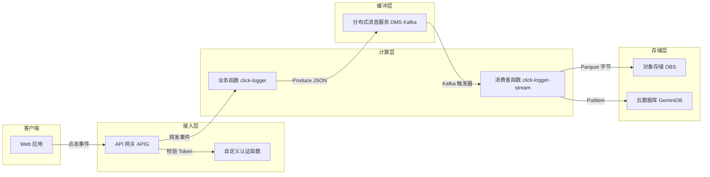

# data-integration-click-logs / 点击日志采集

[](LICENSE)
[](https://support.huaweicloud.com/intl/en-us/)
[](#)
> 点击日志采集：网关接入、Kafka 缓冲、列式落盘与键值查询的一条完整链路
---

## 1. 简介 / Overview

本实践给出一条基于华为云的点击日志采集链路：API 网关接收 Web 应用的点击事件，业务函数把事件投递到分布式消息服务（DMS Kafka）主题；Kafka 触发器异步唤起消费者函数，由消费者函数将事件序列化为 Parquet 字节、按日期分区落桶到对象存储服务（OBS），同时通过兼容键值协议的接口写入 GeminiDB。

用户每一次点击、每一次页面跳转都会产生大量交互信号，把它们实时落盘既能支撑运营侧的实时看板，也能为后续离线分析沉淀统一的原始数据。本实践把采集、缓冲、序列化、存储四段编排为一条可独立伸缩的链路，降低接入方的开发与运维负担。适用于运营埋点、产品漏斗分析、异常点击审计、推荐效果回放等场景，面向 DevOps、后端、数据工程与安全运维工程师，可作为参考架构、学习样例或生产模板使用。

### 核心能力

- **网关接入与白名单鉴权**：API 网关调用自定义认证函数校验请求头中的 Token，仅放行白名单命中的请求。
- **Kafka 缓冲与阶段解耦**：入口只承担校验与投递，数据落地由消费者函数承担，两段可独立伸缩。
- **Parquet 列式落盘**：以 SNAPPY 压缩的 Parquet 按日期分区写入 OBS，便于离线引擎做列裁剪与谓词下推。
- **键值协议写入**：事件同时写入 GeminiDB，既有键值数据模型与客户端写法可平滑沿用。
- **全链路可观测**：网关、函数与 Kafka 运行日志集中到云日志服务（LTS），便于问题定位。
- **基础设施即代码**：全部资源由 Terraform 描述，函数代码以 Maven 工程组织，便于纳入 CI/CD。

---

---

## 2. 目录

- [1. 简介 / Overview](#1-简介--overview)
- [2. 目录](#2-目录)
- [3. 架构图](#3-架构图)
- [4. 方案亮点](#4-方案亮点)
- [5. 涉及云服务](#5-涉及云服务)
- [6. 前置条件](#6-前置条件)
- [7. 快速开始](#7-快速开始)
- [8. 分步部署](#8-分步部署)
- [9. 使用方法 / 验证](#9-使用方法--验证)
- [10. 清理资源](#10-清理资源)
- [11. 详细说明](#11-详细说明)
- [12. 依赖](#12-依赖)
- [13. FAQ / 故障排除](#13-faq--故障排除)
- [14. 贡献指南](#14-贡献指南)
- [15. 许可证](#15-许可证)
- [16. 联系方式 / 维护者](#16-联系方式--维护者)

---

---

## 3. 架构图

> 用一条 DMS Kafka 消息队列把「对外接收入口」与「数据落地」拆开：入口轻、落地可独立伸缩。



**关键组件说明**：

- **API 网关（APIG）**：唯一对外入口，负责请求路由与自定义认证。
- **函数工作流（FunctionGraph）**：承载自定义认证、事件投递、流消费三类职责。
- **分布式消息服务（DMS Kafka）**：业务入口与数据落地之间的流式缓冲通道，由 Kafka 触发器拉起消费者函数。
- **对象存储服务（OBS）**：按日期分区存放 Parquet 字节，作为离线分析的统一数据源。
- **云数据库 GeminiDB**：以兼容键值协议的表存储事件记录，支撑按主键的实时读取。

---

---

## 4. 方案亮点

- **两步链路 + Kafka 缓冲**：业务入口只负责校验与投递，数据落地由消费者函数承担，业务写入与数据落地解耦，可独立扩展并保留「流式缓冲 + 格式转换 + 多路投递」的链路语义。
- **Parquet 列存**：消费者函数以 Parquet 列式格式落盘，配合 SNAPPY 压缩，离线分析引擎可直接做列裁剪与谓词下推，扫描效率更高。
- **Token 自定义鉴权**：API 网关通过自定义认证函数校验请求头中的 Token，只有白名单命中的请求才会被放行，有效阻止非法写入。
- **兼容键值协议的 GeminiDB 表存储**：消费者函数以键值风格接口写入 GeminiDB，既有数据模型与客户端写法可以平滑沿用，无需重写数据访问层。
- **OBS 生命周期管理**：对象存储按日期分区存放 Parquet，并对 `clicklog/` 前缀配置 30 天过期清理，保持存储结构清晰可控。
- **Kafka 触发器近实时消费**：通过 Kafka 触发器实现「事件入 → 函数消费」的近实时链路，相比同步写库降低了 API 调用响应延迟。

---

---

## 5. 涉及云服务

| 服务 | 用途 | 备注 |
|---|---|---|
| API 网关（APIG） | 接收点击事件并执行自定义认证 | 实例开启自定义认证，绑定认证函数 |
| 函数工作流（FunctionGraph） | 运行认证、投递、消费三类函数 | Java 8 运行时，业务与消费函数绑定 VPC |
| 分布式消息服务（DMS Kafka） | 作为流式缓冲通道 | 单主题 1 分区，VPC 内明文访问 |
| 对象存储服务（OBS） | 存放 Parquet 文件与函数代码包 | 桶名需全局唯一，开启版本控制 |
| 云数据库 GeminiDB | 以兼容键值协议的表存储事件记录 | 兼容键值协议接口，3 节点集群 |
| 统一身份认证服务（IAM） | 为函数发放访问其他云服务的委托 | 委托授权覆盖对象存储与 Kafka 主题 |
| 云日志服务（LTS） | 汇集函数、Kafka 与网关的运行日志 | 每个函数绑定一条日志流 |
| 虚拟私有云（VPC） | 承载函数与数据库的网络平面 | 独立子网与安全组，收敛暴露面 |

> **提示**：以上资源均可通过本仓库的 Terraform 配置一键创建；如需清理，请参见[第 10 节「清理资源」](#10-清理资源)。

---

---

## 6. 前置条件

| 项 | 要求 | 说明 |
|---|---|---|
| **账号** | 已开通华为云账号并完成实名认证 | 个人 / 企业账号均可 |
| **权限** | IAM **Tenant Administrator** 或等效权限 | 用于创建 VPC、APIG、FunctionGraph、GeminiDB 等资源 |
| **Region** | 推荐 `cn-north-4` | 跨区域可能存在服务可用性差异 |
| **Terraform** | `>= 1.5.0` | IaC 部署工具 |
| **huaweicloud Provider** | `~> 1.97` | 华为云 Terraform Provider |
| **JDK / Maven** | Java 8（函数运行时为 Java 8）、Maven `>= 3.6` | 本地构建函数代码包 |
| **函数运行时接口包** | 按 `src/clicklogger/lib/README.md` 下载并放置到 `src/clicklogger/lib/` | 缺少该包本地构建会因找不到运行时接口而失败 |
| **账号域名** | 在「我的凭证」页面的基本信息中获取 | 作为 IAM 委托的归属账号，填入 `domain_name` |
| **obsutil** *(可选)* | `>= 5.5.0` | 查看 / 下载 OBS 桶内对象（按需） |
| **AK/SK** | 在华为云「我的凭证」页面获取 Access Key ID 与 Secret Access Key，并填入部署脚本 | **不要**将凭据写入任何代码或配置文件 |

---

---

## 7. 快速开始

### 一键部署（推荐）

```bash
# 1. 克隆本仓库
git clone https://github.com/huaweicloud-samples/data-integration-click-logs.git data-integration-click-logs
cd data-integration-click-logs

# 2. 构建函数代码包（Terraform 会从 target/ 目录读取）
cd src/clicklogger
mvn clean package -DskipTests
cd ../..

# 3. 准备华为云 AK/SK（参见 [前置条件 §6](#6-前置条件)）
export HW_ACCESS_KEY="<your-access-key>"
export HW_SECRET_KEY="<your-secret-key>"
export TF_VAR_geminidb_password="<your-instance-password>"

# 4. 声明账号域名
cd infra
cp terraform.tfvars.example terraform.tfvars
# 编辑 terraform.tfvars，填写 domain_name 与 obs_bucket_name

# 5. 一键部署
terraform init
terraform plan
terraform apply
```

> **部署耗时**：约 10-20 分钟（含函数代码包上传与 GeminiDB 实例创建）。
> **部署后还有两步收尾**（设置函数密钥配置项、回填键值库接入地址），完整步骤与每步预期输出见[第 8 节「分步部署」](#8-分步部署)。

---

---

## 8. 分步部署

### 步骤 1：获取代码

```bash
cd data-integration-click-logs
```

**预期输出**：当前目录包含 `infra/`、`src/`、`docs/`、`README.md` 等文件与目录。

### 步骤 2：构建 Java 函数

```bash
cd src/clicklogger
mvn clean package -DskipTests
```

**预期输出**：出现 `BUILD SUCCESS`，并在 `src/clicklogger/target/` 下生成 `clicklogger-1.0-SNAPSHOT.jar`。Terraform 会把这个文件上传到 OBS 作为三个函数共用的代码包。若本地未配置 Maven 镜像，首次构建会下载较多依赖，请保持网络连通。

### 步骤 3：初始化基础设施

```bash
cd ../infra
terraform init
```

**预期输出**：出现 `Initializing the backend...` 与 `Terraform has been successfully initialized!`，本地生成 `.terraform` 目录。

### 步骤 4：校验与预览

```bash
terraform validate
terraform plan
```

**预期输出**：先出现 `Success! The configuration is valid.`，随后 plan 列出即将创建的资源清单。

### 步骤 5：执行部署

```bash
terraform apply
```

**预期输出**：逐项创建资源，末尾出现 `Apply complete!`，并打印 `apig_api_url`、`obs_bucket_name`、`geminidb_instance_id`、`functiongraph_click_logger_urn` 等输出值。请记录这些值，后续验证会用到。

### 步骤 6：设置函数密钥配置项

出于凭据安全考虑，访问密钥与数据库密码不随基础设施代码下发，请在函数详情页的「配置」标签中单独添加：

| 函数 | 配置项 | 取值 |
|---|---|---|
| `data-integration-click-logs-click-logger` | `HUAWEICLOUD_SDK_AK` / `HUAWEICLOUD_SDK_SK` | 在「我的凭证」页面获取的 Access Key ID 与 Secret Access Key |
| `data-integration-click-logs-click-logger-stream` | `HUAWEICLOUD_SDK_AK` / `HUAWEICLOUD_SDK_SK` | 同上，用于访问 OBS |
| `data-integration-click-logs-click-logger-stream` | `GEMINIDB_PASSWORD` | 与 `terraform.tfvars` 中 `geminidb_password` 一致 |

**预期输出**：保存后函数无需重新部署代码，配置项在下次调用时生效。

### 步骤 7：回填键值库接入地址

键值库兼容接口的接入地址是实例级的，无法从区域推导。实例创建完成后，取出 `terraform output -raw geminidb_endpoint` 得到的负载均衡地址，补上协议与端口后填入 `terraform.tfvars` 的 `geminidb_endpoint`（形如 `http://<负载均衡地址>:8000`，端口以控制台实例详情页显示为准）：

```bash
terraform output -raw geminidb_endpoint
# 将结果补全为 http://<负载均衡地址>:<端口>，写入 terraform.tfvars 的 geminidb_endpoint
terraform apply
```

**预期输出**：第二次 apply 只更新消费者函数的配置项（`GEMINIDB_ENDPOINT`），用户可看到少量 in-place 变更。

---

---

## 9. 使用方法 / 验证

> **验证提醒**：本节所列命令与示例已通过静态校验（`terraform fmt -check`、`terraform validate`）与代码级检查；端到端链路需要在真实账号环境中按以下步骤执行，确认四条链路（网关鉴权、Kafka 投递、对象存储写入、键值库写入）均正常后，方可视为交付完成。

### 验证 1：网关鉴权与事件受理

```bash
# 发送一条点击事件（<apig-url> 取自 terraform output apig_api_url）
curl -X POST https://<apig-url>/clicklogger \
  -H "Authorization: ALLOW=ORDERAPP" \
  -H "Content-Type: application/json" \
  -d '{"requestid":"r-001","contextid":"c-001","callerid":"web","component":"login","action":"click","type":"webpage","user":"alice","clientip":"10.0.0.1"}'
```

**预期输出**：

```
{"message":"ok"}
```

HTTP 状态码为 200。再发送一条未命中白名单的请求（`-H "Authorization: ALLOW=OTHER"`），预期返回 HTTP 401 并被网关拒绝。

### 验证 2：对象存储落盘

```bash
# 列出当天分区下的对象（obsutil 需先完成配置）
obsutil ls obs://<bucket-name>/clicklog/data=YYYY-MM-DD/
```

**预期输出**：出现形如 `<timestamp>-r-001.parquet` 的对象，文件大小约 1-3 KB（单条记录）。

### 验证 3：键值库写入

在 LTS 中检索函数 `data-integration-click-logs-click-logger-stream` 的日志流，确认出现：

```
record stored, requestid=r-001
```

该行由消费者函数在 `PutItem` 成功后打印，是键值写入成功的直接证据；同一日志流还会出现 `object stored, key=clicklog/data=.../...-r-001.parquet`。也可用任意兼容键值协议的客户端按主键 `requestid=r-001`、`contextid=c-001` 读取该记录。

### 验证 4：业务端到端（推荐）

```bash
# 连发 3 条不同调用方的事件，覆盖白名单与字段校验
for n in 001 002 003; do
  curl -s -o /dev/null -w "%{http_code}\n" -X POST https://<apig-url>/clicklogger \
    -H "Authorization: ALLOW=ORDERAPP" \
    -H "Content-Type: application/json" \
    -d "{\"requestid\":\"r-$n\",\"contextid\":\"c-$n\",\"callerid\":\"web\",\"component\":\"login\",\"action\":\"click\",\"type\":\"webpage\"}"
done
```

**预期结果**：三条请求均返回 `200`；等待数秒后（Kafka 触发器按批拉起消费者函数，`pull_period` 为 30 秒），`obs://<bucket-name>/clicklog/data=YYYY-MM-DD/` 下出现 3 个新的 Parquet 对象，`click_log_table` 中出现 3 条主键为 `r-001` / `r-002` / `r-003` 的记录。

> **说明**：由于链路经由 Kafka 主题异步消费，落盘与写库相对 HTTP 响应有秒级到数十秒的延迟，属预期行为。
>
> **请在你的环境中实际执行上述验证，确认业务功能可用后再对外交付。**

---

---

## 10. 清理资源

```bash
# 进入部署目录
cd data-integration-click-logs/infra

# 一键释放所有资源
terraform destroy
```

**预期输出**：`Destroy complete! Resources: N destroyed.`

> **避免资源残留**：
> - `terraform destroy` 仅释放 Terraform state 中追踪的资源。本实践的 OBS 桶开启了 `force_destroy`，桶内对象会随之删除；若桶中仍存在非本次部署产生的对象，请先清空后再执行销毁。
> - 若中途通过 API 直接创建过资源（例如手工上传的 OBS 对象、控制台手动创建的 EIP），需手动释放。
> - 公共资源（账号内其他任务共享的 NAT / VPC 等）不会被影响。

---

---

## 11. 详细说明

### 11.1 工作流程

1. **接入**：Web 应用把点击事件 POST 到 API 网关的 `/clicklogger` 路径。
2. **鉴权**：网关先把请求头 `Authorization` 交给自定义认证函数；该函数比对白名单，返回 Allow 或 Deny，只有命中白名单的请求才会被转发到后端。
3. **投递**：业务函数 `click-logger` 解析 JSON，校验 6 个核心字段并补齐可选字段的默认值，再通过 DMS Kafka 生产者客户端把事件投递到 Kafka 主题，随后立即返回受理结果。
4. **缓冲**：DMS Kafka 主题按分区暂存事件，起到削峰与解耦作用。
5. **消费**：Kafka 触发器按 30 秒周期、单批最大 2 MB、串行方式拉起消费者函数 `click-logger-stream`。
6. **落地**：消费者函数把每条记录反序列化为事件对象 → 以 SNAPPY 压缩生成 Parquet 字节 → 通过 OBS SDK 的 `PutObject` 上传到 `clicklog/data=<日期>/` 前缀 → 通过键值协议的 `PutItem` 写入 `click_log_table`。

### 11.2 配置项

| 变量 | 默认值 | 说明 |
|---|---|---|
| `region` | `cn-north-4` | 资源部署区域 |
| `project_name` | `data-integration-click-logs` | 资源名称前缀，同时决定三个函数的名称 |
| `project_id` | 空 | 项目 ID；留空时按区域名自动解析 |
| `domain_name` | 无（必填） | 账号名，即 IAM 委托的归属账号 |
| `vpc_cidr` | `10.0.0.0/16` | 虚拟私有云网段 |
| `subnet_cidr` | `10.0.1.0/24` | 子网网段 |
| `availability_zone` | `cn-north-4a` | 子网所在可用区 |
| `availability_zones` | `cn-north-4a,cn-north-4b,cn-north-4c` | 键值库集群可用区 |
| `obs_bucket_name` | `data-integration-click-logs-parquet` | 对象存储桶名，需全局唯一 |
| `kafka_topic_partitions` | `1` | DMS Kafka 主题分区数 |
| `geminidb_flavor` | `geminidb.dynamodb.xlarge.4` | 键值库实例规格码 |
| `geminidb_node_count` | `3` | 键值库实例节点数 |
| `geminidb_storage_size` | `100` | 键值库单节点存储空间（GB） |
| `geminidb_password` | 无（必填，敏感） | 键值库实例密码，长度 8-32 位且包含大小写字母、数字、特殊字符中的三类 |
| `geminidb_user` | `rwuser` | 键值库数据面使用的实例账号，实例创建时确定 |
| `geminidb_endpoint` | 空 | 兼容接口接入地址，实例创建后按输出回填 |
| `geminidb_table` | `click_log_table` | 承载点击日志的数据表名称 |
| `auth_tokens` | `ALLOW=ORDERAPP;ALLOW=BILLAPP;` | 鉴权白名单，分号分隔，格式为 `ALLOW=<调用方标识>` |
| `functiongraph_jar_obs_path` | `function-code/click-logger.jar` | 函数代码包在对象存储中的对象路径 |
| `function_memory_size` | `2048` | 业务与消费函数内存大小（MB） |
| `function_timeout` | `300` | 业务与消费函数超时时间（秒） |

函数侧的非敏感配置项（`REGION`、`PROJECT_ID`、`OBS_ENDPOINT`、`KAFKA_BOOTSTRAP_SERVERS`、`KAFKA_TOPIC`、`OBS_BUCKET`、`GEMINIDB_ENDPOINT`、`GEMINIDB_USER`、`GEMINIDB_TABLE`、`AUTH_TOKENS`）由 Terraform 随函数一次性下发；访问密钥与数据库密码按[第 8 节步骤 6](#8-分步部署)单独设置。

### 11.3 接口 / API

**入口接口**

| 项 | 内容 |
|---|---|
| 方法 / 路径 | `POST /clicklogger` |
| 认证 | 请求头 `Authorization`，取值需命中白名单（如 `ALLOW=ORDERAPP`） |
| 请求体 | JSON，包含 9 个字符串字段 |
| 成功响应 | `200` + `{"message":"ok"}`，并带 `Access-Control-Allow-Origin` 响应头 |
| 失败响应 | `400` + `{"message":"<原因>"}` 或网关返回 `401`（未命中白名单） |

**请求示例**

```json
{
  "requestid": "r-001",
  "contextid": "c-001",
  "callerid": "web",
  "component": "login",
  "action": "click",
  "type": "webpage",
  "user": "alice",
  "clientip": "10.0.0.1",
  "createdtime": "09-17-2026 10:30:00"
}
```

**事件字段与 Parquet Schema**

| 字段 | 类型 | 必填 | 说明 |
|---|---|---|---|
| `requestid` | string | 是 | 请求唯一标识，同时作为 Kafka 分区键与数据表分区键 |
| `contextid` | string | 是 | 会话或上下文标识，同时作为数据表排序键 |
| `callerid` | string | 是 | 调用方标识 |
| `component` | string | 是 | 产生事件的前端组件 |
| `action` | string | 是 | 动作类型，例如 click |
| `type` | string | 是 | 事件类型，例如 webpage |
| `user` | string | 否 | 用户标识，缺省补 `GUEST` |
| `clientip` | string | 否 | 客户端 IP，缺省补 `APIGWY` |
| `createdtime` | string | 否 | 事件产生时间，缺省补当前时间（`MM-dd-yyyy HH:mm:ss`） |

序列化时，9 个字段映射为 Parquet 的 9 个字符串列；日期分区体现在对象键前缀 `clicklog/data=YYYY-MM-DD/` 上，便于离线引擎按日期裁剪扫描范围。

**数据表结构**

消费者函数在首次写入时以幂等方式创建表与索引（无需手工初始化）：

| 项 | 内容 |
|---|---|
| 表名 | `click_log_table`（由 `geminidb_table` 决定） |
| 主键 | 分区键 `requestid` + 排序键 `contextid` |
| 二级索引 | `ContextCallerIndex`（分区键 `contextid` + 排序键 `callerid`，投影全部属性） |

---

---

## 12. 依赖

| 名称 | 版本 | 用途 |
|---|---|---|
| Terraform | `>= 1.5.0` | IaC 编排 |
| huaweicloud Provider | `~> 1.97` | 华为云资源 |
| JDK | Java 8 | 函数运行时（`Java8`） |
| Maven | `>= 3.6` | 函数代码构建 |
| Parquet | `1.12` | 列式序列化（`parquet-avro`） |
| Avro | `1.11` | Parquet 写入所需的记录模型 |
| Hadoop Common | `3.3` | Parquet 写入所需的文件系统与配置抽象 |
| esdk-obs-java | `3.20` | 对象存储 SDK |
| kafka-clients | `3.4.1` | DMS Kafka 生产者客户端 |
| fss-java-sdk | `2.0` | 函数运行时接口（运行时提供，本地构建需按 `src/clicklogger/lib/README.md` 放置） |
| 兼容键值协议的客户端 | `1.12` | 键值库数据面读写（精确坐标见 `src/clicklogger/pom.xml`） |
| Gson | `2.10` | JSON 解析与序列化 |
| commons-lang3 | `3.13` | 字符串工具 |
| slf4j | `1.7` | 日志门面 |

---

---

## 13. FAQ / 故障排除

### Q1：部署时提示「权限不足」怎么办？

**A**：确认账号具备 IAM **Tenant Administrator** 权限，或至少包含 `VPC Administrator`、`APIG Administrator`、`FunctionGraph Administrator`、`DMS Administrator`、`OBS Administrator`、`GeminiDB Administrator` 等子服务管理员权限。

### Q2：OBS 桶名提示已存在怎么办？

**A**：桶名全局唯一。若 `terraform apply` 提示桶名已存在或已被占用，请在 `terraform.tfvars` 中把 `obs_bucket_name` 改为带随机后缀的唯一名称后重试。

### Q3：事件已受理，但 OBS 与 GeminiDB 里没有数据？

**A**：链路经由 Kafka 主题异步消费，请先确认主题中已累积数据，再检查 `click-logger-stream` 的函数日志：若日志中出现 `key-value store connection configuration is incomplete`，说明第 7 步的接入地址尚未回填或密码未设置；若出现 `object storage access credentials are not configured`，说明第 6 步的密钥配置项缺失。

### Q4：GeminiDB 密码有什么要求？

**A**：密码需满足长度 8-32 位、且包含大小写字母、数字、特殊字符中的至少三类的复杂度要求。请通过 `TF_VAR_geminidb_password` 或 `-var` 传入，不要写入会被提交的文件。

### Q5：APIG 自定义认证的响应格式是什么？

**A**：认证函数返回 `{"statusCode":200,"body":"{\"status\":\"allow|deny\",\"context\":{...}}"}`，网关据此决定是否放行；未命中白名单时返回 401 与 `{"status":"deny"}`。

### Q6：FunctionGraph 访问 OBS 与 Kafka 主题需要什么权限？

**A**：函数通过 IAM 委托获得权限，委托需同时覆盖对象存储写入与 Kafka 主题读取。请确认委托已绑定到函数，且策略覆盖目标桶与目标主题。

### Q7：自定义认证 Token 含特殊字符如何处理？

**A**：建议在网关侧对 Token 做 URL 编码，业务侧按相同规则解码后比对白名单，避免分隔符冲突。

### 故障排查清单

| 现象 | 可能原因 | 排查方法 |
|---|---|---|
| `terraform apply` 报权限不足 | 账号缺少对应子服务管理员权限 | 按 Q1 补齐权限或换用具备 Tenant Administrator 的账号 |
| 函数创建失败，提示找不到代码包 | 未先执行 `mvn package`，或 `target/` 下未生成 jar | 回到[步骤 2](#8-分步部署)重新构建，确认生成 `clicklogger-1.0-SNAPSHOT.jar` |
| curl 返回 401 | 请求头 `Authorization` 未命中 `auth_tokens` 白名单 | 核对白名单取值与请求头是否完全一致（含大小写与分隔符） |
| curl 返回 400，`message` 为某字段 missing | 请求体缺核心字段 | 按[第 11.3 节](#11-详细说明)补齐 6 个必填字段 |
| 主题中有数据但桶里没有 Parquet | 触发器未生效、批次未拉起，或函数配置项缺失 | 在 LTS 查看 `click-logger-stream` 日志；确认 Kafka 触发器状态为 `ACTIVE` |
| Parquet 写入失败 | SNAPPY 依赖缺失、OBS 端点或访问密钥异常 | 查看函数日志中的异常栈，核对 `OBS_ENDPOINT` 与密钥配置项 |
| 键值写入失败 | 接入地址未回填、密码错误，或网络不通 | 执行[步骤 7](#8-分步部署)回填地址；确认函数已加入 VPC 且安全组放通实例端口 |
| 分步执行时更改变量后配置未生效 | 修改的是 `terraform.tfvars`，未重新 apply | 在 `infra/` 目录重新执行 `terraform apply` |

---

---

## 14. 贡献指南

欢迎提交 Issue 与 Pull Request。请遵循以下流程：

1. **Issue**：描述问题或建议，附复现命令、预期与实际输出、相关截图。
2. **PR**：基于 `main` 分支新建 feature 分支；提交前运行 `terraform fmt -check` 与 `terraform validate`，并确认函数代码可本地构建（`mvn clean package -DskipTests`）。
3. **Code Review**：由 **[@huaweicloud-samples](https://github.com/huaweicloud-samples)** 审核通过后合并。

请保持变更聚焦、提交信息清晰；基础设施变更请在 PR 描述中附上 `terraform plan` 的差异摘要。

---

---

## 15. 许可证

本实践采用 **MIT No Attribution** 许可证发布。详见仓库根目录 [`LICENSE`](LICENSE) 文件。

```
MIT No Attribution

Copyright (c) Huawei Cloud

Permission is hereby granted, free of charge, to any person obtaining a copy
of this software... (no attribution required)
```

---

---

## 16. 联系方式 / 维护者
| 项 | 内容 |
|---|---|
| **创建者** | [dgc-git](https://github.com/dgc-git) |
| **维护者** | [dgc-git](https://github.com/dgc-git) |
| **联系方式** | GitHub Issues / PR（见[第 14 节](#14-贡献指南)） |
