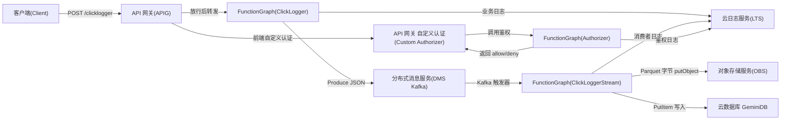
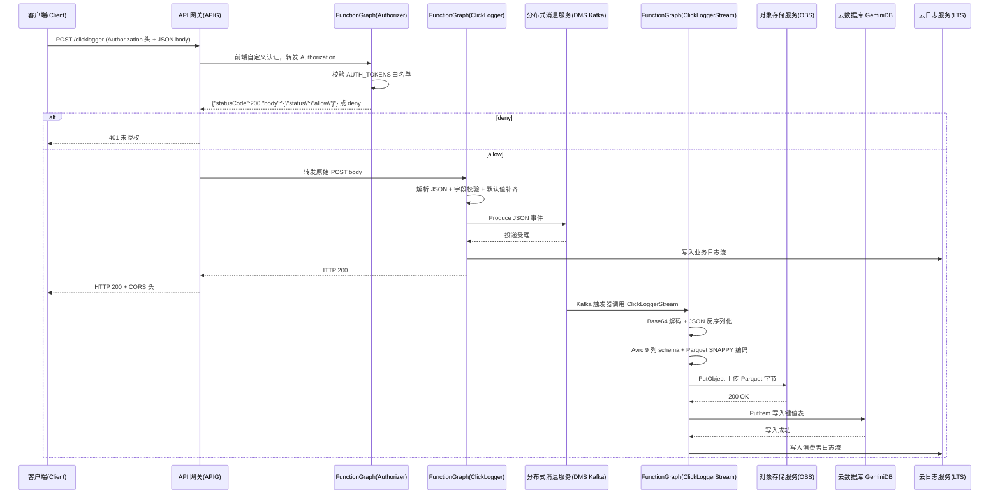

# 架构说明

## 1. 概述

本实践提供一套端到端的点击日志采集与落盘方案：Web 或移动端应用通过 API 网关将用户行为事件实时上报，业务函数接收后写入 DMS Kafka 主题；Kafka 触发器拉起的消费者函数进一步把事件以 Parquet 列存格式写入对象存储桶（按日期分区），并同步写入兼容键值协议的数据库，供实时查询与离线分析使用。

方案采用"业务写入与数据落地解耦"的两步链路：业务入口只负责字段校验与事件投递，列存序列化、对象存储写入、键值库写入由 Kafka 触发器拉起的消费者承担。这一结构既保留了"流式缓冲 + 转换 + 投递"的链路语义，又通过异步触发获得了消费端独立扩展的能力。原始事件以 Parquet 列存形式长期留存于对象存储，结构化记录以键值形式实时写入 GeminiDB，两类存储互为补充，分别服务离线分析与实时检索。

## 2. 架构图

说明：客户端通过 API 网关进入系统，前端自定义认证在网关层拦截非法请求；放行后业务函数 ClickLogger 把事件投递到 DMS Kafka 主题；Kafka 触发器调用消费者函数 ClickLoggerStream 完成 Parquet 序列化、对象存储落桶与键值库写入；三类函数日志统一汇聚到 LTS，形成完整可观测链路。

## 3. 组件详解

### 3.1 API 网关（API Gateway / APIG）

采用专享版 BASIC 实例，对外暴露 `POST /clicklogger` 端点接收点击日志事件。实例开启前端自定义认证（前端类型 + 函数模式），在请求进入业务逻辑前调用 Authorizer FunctionGraph 完成 Token 校验，非法请求在网关层即被拒绝，不会到达业务函数。端点同时开启 CORS 以支持浏览器跨域上报，并可根据需要配置流控与访问日志。

POST 请求的 body 为 JSON，包含 8 个事件字段：requestid、contextid、callerid、component、action、type、user、clientip。其中前 6 个为必填字段，后 2 个（user、clientip）可由业务函数补齐默认值，降低上报端的负担。

### 3.2 Authorizer FunctionGraph

作为 API 网关的前端自定义认证后端，从函数配置项 `AUTH_TOKENS`（分号分隔的白名单）读取允许调用的调用方标识列表，校验请求头 `Authorization` 的值是否落在白名单内。校验通过返回 `{"statusCode":200,"body":"{\"status\":\"allow\",\"context\":{...}}"}`，未通过返回 `{"statusCode":401,"body":"{\"status\":\"deny\",...}"}`，由 API 网关据此决定是否放行请求。

该函数的职责单一、执行轻量，仅做白名单比对，不访问外部存储，因此鉴权延迟极低。所有鉴权行为会写入 LTS 的鉴权日志流，便于审计哪些标识被使用、哪些请求被拒绝，也方便在白名单变更时回溯历史。

### 3.3 ClickLogger FunctionGraph（业务入口）

业务核心函数的第一段，负责把上报事件投递到 DMS Kafka 主题。处理流程如下：

1. 解析 JSON body（若请求体标记为 Base64 编码则先解码）；
2. 校验 6 个必填字段：requestid / contextid / callerid / component / action / type，缺失或为空则直接返回 4xx；
3. 补齐 3 个默认值：user 缺省为 "GUEST"、clientip 缺省为 "APIGWY"、createdtime 缺省为当前时间；
4. 将 ClickLogRequest 序列化为 JSON 字符串；
5. 通过 DMS Kafka 生产者客户端将事件投递到 Kafka 主题，分区键取 requestid（确保同一请求有序）。

该函数通过委托获得 Kafka 主题写入与对象存储读取（拉取函数代码）权限，运行过程中将关键步骤记录到 LTS 业务日志流，便于在写入失败时定位原因。

### 3.4 分布式消息服务（DMS Kafka）

作为业务入口与数据落地之间的流式缓冲通道，承担"写入解耦与按批消费"的职责。Kafka 主题按 `kafka_topic_partitions`（默认 1）建立分区，分区键取 requestid，保证同一请求的事件在同一分区内有序消费。

Kafka 通过触发器（FunctionGraph KAFKA 触发器）调用下游消费者函数，实现按批拉取与可靠投递。

### 3.5 ClickLoggerStream FunctionGraph（Kafka 消费者）

业务核心函数的第二段，由 Kafka 触发器异步调用，负责把事件落盘到对象存储与键值库。处理流程如下：

1. 从触发事件的记录列表中取出数据载荷，按 Base64 解码（非 Base64 时按明文处理），反序列化为 ClickLogRequest；
2. 按 Apache Avro 定义的 9 列 schema 组装记录：requestid、contextid、callerid、component、action、type、clientip、user、createdtime，均为 string；
3. 通过 Apache Parquet 以 SNAPPY 压缩编码为字节流；
4. 调用 OBS SDK 的 PutObject，将 Parquet 字节上传至 `clicklog/data=YYYY-MM-DD/<timestamp>-<requestid>.parquet`；
5. 通过键值协议客户端的 PutItem 写入键值表；表与二级索引在首次写入时按幂等方式创建，无需手工初始化。

该函数通过委托获得对象存储写入（含函数代码读取）权限，键值库写入使用实例自带账号；运行过程中将关键步骤记录到 LTS 消费者日志流，便于在写入失败时定位原因。

### 3.6 对象存储服务（OBS）

用于存储 Parquet 落桶文件。桶 ACL 设为私有读写，开启版本控制，并配置生命周期规则：`clicklog/` 前缀下的对象保留 30 天后自动清理，函数代码包不受影响。按 `data=YYYY-MM-DD` 日期分区组织对象，使下游 Spark / Hive / DLI 可按分区谓词高效扫描，无需遍历全量数据。

### 3.7 云数据库 GeminiDB

采用 Cluster 模式部署，datastore 为 DynamoDB 兼容类型（`datastore.type = "dynamodb"` 小写，`version = ""` 空串，`storage_engine = "rocksDB"`），多可用区部署保障高可用。键值表 `click_log_table` 主键为 requestid + contextid，并建有二级索引 `ContextCallerIndex`（partition_key = contextid，sort_key = callerid），便于按上下文与调用方维度检索。

兼容接口使既有业务代码以最小改动接入键值库：数据面鉴权使用实例自带的数据库账号（`rwuser`）与实例管理员密码，不接受云平台访问密钥；接入地址为实例的负载均衡地址与端口，需在实例创建后回填到配置中。

### 3.8 云日志服务（LTS）

统一收集三类函数日志，分别写入三个日志流：业务入口函数（`click-logger-business`）、消费者函数（`click-logger-consumer`）、鉴权函数（`click-logger-authorizer`）。日志保留期为 7 天，用于排障与审计。通过将日志按用途分流到不同日志流，运维可按主题快速定位问题，例如鉴权失败看 `click-logger-authorizer`，写入异常看 `click-logger-business` 或 `click-logger-consumer`。网关访问日志可通过网关侧的日志能力另行开启。

### 3.9 统一身份认证（IAM）

创建委托 `${project_name}-fgs-agency`，使 FunctionGraph 获得访问 OBS 与 Kafka 主题的权限。委托策略包含两项服务权限：OBS OperateAccess、DMS Administrator，以最小权限覆盖落桶、函数代码读取与 Kafka 主题投递所需操作。函数的平台侧身份通过该委托获得，函数代码无需保存长期密钥；访问对象存储时使用部署期注入的访问密钥配置项。

### 3.10 虚拟私有云（VPC）

采用单 subnet、单 AZ 的精简网络。安全组规则允许子网内部互通，并放行函数与网关的出方向流量，确保业务函数可访问 OBS、GeminiDB 实例与 Kafka 服务端点。网络拓扑保持最小复杂度，便于理解与上手，后续如需跨 AZ 高可用可在此基础上扩展。

## 4. 数据流

时序说明：客户端上报后先经过网关层鉴权，鉴权拒绝则直接返回 401；鉴权通过后业务函数 ClickLogger 完成字段校验、JSON 序列化、向 Kafka 投递记录并立即返回 200。异步路径由 Kafka 触发器拉起 ClickLoggerStream 完成 Parquet 编码、OBS 落桶与 GeminiDB 写入。三类函数日志贯穿始终，可在 LTS 中回放完整调用链。

## 5. 关键设计决策

- 两步链路 + Kafka 缓冲：业务写入与数据落地解耦，业务函数仅做"校验 + 投递"，消费者函数做"序列化 + 落桶 + 落库"，可独立扩展并完整保留"流式缓冲 + 格式转换 + 多路投递"的链路语义。
- Parquet 列存落桶：采用 SNAPPY 压缩、9 列固定 schema，对象存储中的文件按日期分区，下游可直接使用 DLI / Spark / Hive 进行列式查询与分析，无需额外 ETL 即可消费。
- 兼容键值协议的存储：业务代码使用兼容键值协议的客户端，仅需将接入地址指向实例的负载均衡地址，已有键值型应用可平滑接入；数据面鉴权使用实例账号与密码。
- Token 自定义鉴权：采用白名单模式，无需引入独立用户系统即可快速验证调用方身份；生产环境可对接网关自带的 IAM 认证或 API 密钥机制以获得更强安全性。

## 6. 适用场景

- Web / APP 端实时用户行为埋点：页面点击、按钮触发、元素曝光等高频事件实时入库。
- 业务事件流式采集：点击、表单提交、页面停留、接口调用等业务事件统一采集。
- 离线 BI / 用户画像 / 行为分析：Parquet 落桶文件可直接被大数据引擎消费，支撑用户路径分析、留存分析、画像构建等场景。

## 7. 限制与边界

- 业务入口到数据落桶之间为异步链路：客户端调用返回 200 后 Parquet 文件与键值库记录的最终落盘由消费者函数异步完成，不在 API 调用同步等待范围内。
- 键值库的兼容接口不支持部分高级特性（如变更流捕获），若业务依赖变更流需另行设计。
- Token 鉴权为演示用途，生产环境建议对接真实身份系统，并通过网关的限流、WAF 等能力增强防护。
- 数据表与二级索引由消费者函数在首次写入时创建，首次调用会承担一次建表开销；如需纳入变更管理，可在实例创建后手工建表并保持结构一致。
